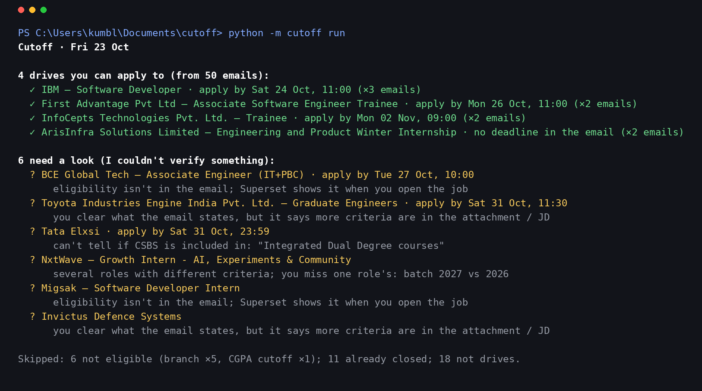

# Cutoff

**A local Gemma reads your placement emails, so you only open the ones you can actually apply to.**

Final-year placement season means a dozen emails a day. Each one hides a CGPA cutoff, a branch list, a batch and a deadline somewhere in the third paragraph, or doesn't say at all and leaves you to click through to the portal. Most of them rule you out. You still have to open every one to find out.

Cutoff reads them for you, using an open-weight model on your own laptop. Here's a real run over one week of my inbox (50 emails, BMS College of Engineering, CSBS, 2027 batch, CGPA 7.08):



```
Cutoff · Fri 23 Oct

4 drives you can apply to (from 50 emails):
  ✓ IBM — Software Developer · apply by Sat 24 Oct, 11:00 (×3 emails)
  ✓ First Advantage Pvt Ltd — Associate Software Engineer Trainee · apply by Mon 26 Oct, 11:00 (×2 emails)
  ✓ InfoCepts Technologies Pvt. Ltd. — Trainee · apply by Mon 02 Nov, 09:00 (×2 emails)
  ✓ ArisInfra Solutions Limited — Engineering and Product Winter Internship · no deadline in the email (×2 emails)

6 need a look (I couldn't verify something):
  ? BCE Global Tech — Associate Engineer (IT+PBC) · apply by Tue 27 Oct, 10:00
      eligibility isn't in the email; Superset shows it when you open the job
  ? Toyota Industries Engine India Pvt. Ltd. — Graduate Engineers · apply by Sat 31 Oct, 11:30
      you clear what the email states, but it says more criteria are in the attachment / JD
  ? NxtWave — Growth Intern - AI, Experiments & Community
      several roles with different criteria; you miss one role's: batch 2027 vs 2026
  ...

Skipped: 6 not eligible (branch ×5, CGPA cutoff ×1); 11 already closed; 18 not drives.
```

Each line in the real digest also carries the email's own Apply link.

## How it works

```
email (.eml / .mbox / .txt)
  → Gemma 4 E4B (Ollama, local) fills a form: every value + the exact sentence it came from
  → grounding: is that sentence really in the email? is the value really in that sentence?
       fail → retry once, naming each rejected value and why
       fail again → UNKNOWN
  → rules vs your profile (CGPA, branch, batch, backlogs, 10th/12th/degree %)
  → ELIGIBLE / NOT_ELIGIBLE / CHECK / CLOSED / NOT_A_DRIVE
  → one line per drive, however many emails it came in
```

**The one rule:** a value that can't be verified is UNKNOWN, and UNKNOWN can send a drive to CHECK but never to "not eligible". Being told "skip it" about a drive you could have applied to is the expensive mistake. Opening one extra email is the cheap one.

The rules that came out of running it on a real inbox:

- **Same company, several emails.** Superset's "Open for application" notices carry no criteria. The placement office usually forwards the company's own email, which does. Cutoff matches them by company, so the notice borrows the forwarded email's criteria. Borrowing can turn CHECK into ELIGIBLE, never into NOT_ELIGIBLE, because the other email might be about a different role.
- **"Criteria are in the attachment."** If the email says so, Cutoff won't call it a clean ELIGIBLE, even if you clear everything the email states.
- **Several roles, different rules.** If a criterion applies to only one of the roles, failing it gives CHECK, not "not eligible".
- **Percentages have a scope.** "70%/7.0 CGPA" for the degree is met by your CGPA. "60% throughout in 10th, 12th, Graduation" checks all three.
- **"CS" is not "CSE".** At my college, Superset let CSBS apply where the email said "CS" but not where it said "Computer Science & Engineering". These are two separate switches in `profile.yaml`.
- **Competitions are not drives.** Hackathons, contests and webinars are skipped by subject line, even when the email promises a PPO.

What grounding catches is in `tests/test_core.py`. Some examples:
- a batch year read from an attachment's file name
- a "January 2027 start" date read as a graduation year
- "60% throughout" read as a CGPA of 6.0
- a branch list that quietly adds a branch the evidence doesn't mention

## Results on a real inbox

50 placement emails from one week (16–23 Oct 2026): 32 were drives, and I could apply to 25 of them. I labelled every field by hand. Where an email didn't state its criteria, the eligibility label comes from what Superset showed when I opened the job.

| | Regex, no AI | Gemma, prompt v1 | Gemma, prompt v3 |
|---|---|---|---|
| **Missed: told "not eligible" but I was** | 3 | 1 | **1** |
| False alarm: told "eligible" but I wasn't | 2 | 2 | **0** |
| Sent to CHECK | 22 | 24 | **10** |
| Company / role correct | 0% / 22% | 100% / 91% | **100% / 100%** |
| Branch list correct | 69% | 81% | **100%** |
| Median seconds per email (Ryzen 5 5500U laptop, 16 GB, no GPU) | – | 67 | **39** |
| Emails that needed a retry | – | 16 | **4** |

The one remaining miss is EY's "please confirm a schedule" email. Gemma calls it "not a drive", and I think that's arguable. Four label corrections made after reviewing v1 are listed, each with its reason, in the labels' notes column. My inbox and labels aren't in this repo because they're my college email. The 10 synthetic emails in `data/fixtures/` reproduce the pipeline end to end.

## Quick start

```bash
# 1. Model (once)
ollama pull gemma4:e4b

# 2. Code
pip install -e ".[dev]"
cp profile.example.yaml profile.yaml       # your CGPA, branch, batch, marks. Gitignored.
python -m cutoff doctor                    # checks Ollama + model

# 3. Try it on the synthetic sample emails
python -m cutoff run --inbox data/fixtures/emails --now 2026-10-24T08:00

# 4. Your own inbox: drop .eml / .txt files (or a Gmail Takeout .mbox) into data/inbox/
python -m cutoff run
```

## Evaluating it

```bash
python -m cutoff prefill                   # draft data/labels.csv from the regex baseline
#   ...open it and correct every cell by hand (blank = the email doesn't say)...
python -m cutoff eval --extractor regex    # the no-AI baseline
python -m cutoff eval                      # Gemma
```

Each run writes `eval/<run>.md` and appends a line to `eval/history.csv`, so prompt versions can be compared side by side. The `.md` report has field accuracy, verdicts, and every mistake with its evidence. The draft labels come from the regex baseline rather than from Gemma, so they don't lean toward the model being tested. Gemma's answers are cached by (model, prompt version, email), so changing a rule and re-scoring takes seconds, not 40 minutes.

## Why open weights

- **Your data stays home.** CGPA, backlogs, marks and a college inbox go nowhere. The model runs on your laptop.
- **It costs nothing to run every night,** and retries are free, so the grounding can afford to be strict.
- **It's reproducible.** Temperature 0, a fixed seed and a response cache mean the same email always gets the same answer, which is what makes an honest eval possible.

## Layout

| | |
|---|---|
| `cutoff/gemma.py` | Ollama call, prompt, retry, cache |
| `cutoff/grounding.py` | checks each value against the email |
| `cutoff/branches.py` | branch aliases and "is my branch in this list" |
| `cutoff/rules.py` | profile + grounded fields → verdict; same-company borrowing |
| `cutoff/regex_baseline.py` | the no-AI baseline |
| `cutoff/evaluate.py` | scores against `labels.csv`, writes the report |
| `cutoff/digest.py` | the digest, one line per drive |
| `cutoff/emails.py` | .eml / .mbox / .txt loading, HTML → text, Apply links, scrubbing classmates' addresses and phone numbers |
| `data/fixtures/` | 10 synthetic emails (made-up companies) for tests and the demo |

Built for the DEV Hacktoberfest 2026 Open-Source AI Challenge, Week 3 ("Slow and Steady"), 19–25 Oct 2026. Any commit after 25 Oct 2026, 23:59 PDT is listed here.

MIT licensed.
